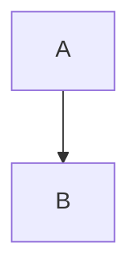

#### 開場｜兩分鐘

# 步驟與堆疊

一份用 `####` 分區塊的簡報。

:::summary
〔開場〕先說這份簡報要測什麼。

第二段講稿。
:::

---

#### 一、逐步顯示

## 清單一項一步

:::build
- 第一項
- 第二項，含 **粗體** 與 `程式碼`
- 第三項
:::

:::summary
清單的三個項目各是一步。
:::

::vertical

## 清單一項一步

:::build
1. 有序清單
2. 也是一項一步
:::

接著是不在 build 裡的段落。

::vertical

### 只有三級標題的頁

:::build
| 元素 | 一步是什麼 |
| ---- | ---------- |
| 清單 | 一個項目   |
| 表格 | 一列       |
| 其他 | 整個區塊   |

一個段落也是一步。

> 引言也是一步。
:::

:::summary
這一頁沒有 `##`，所以仍是上一張投影片的一頁。
:::

---

## 表格不在 build 裡

| 欄 | 值 |
| -- | -- |
| a  | 1  |
| b  | 2  |

::vertical

## 換了標題就是新的一張

::::grid{cols=3}
:::cell
**一**

第一欄
:::
:::cell
**二**

第二欄
:::
:::cell
**三**

第三欄 :icon{name="Star"}
:::
::::

:::info[補充]
資訊框裡的內容，含公式 $a^2 + b^2 = c^2$。
:::

:::summary
這一頁的 `##` 和前一頁不同。
:::

---

#### 二、程式與圖

## 圍籬裡的指令不算

```md
::vertical

:::build
- 這是範例，不是步驟
:::

::summary
```



$$
\frac{1}{2}
$$

:::summary
圍籬裡的 `::vertical` 與 `:::build` 是程式碼。
:::

---

#### 附錄 A｜名詞

## 區塊

講述的一個段落。

***

## 另一種分隔線

`***` 也開始下一張投影片。
